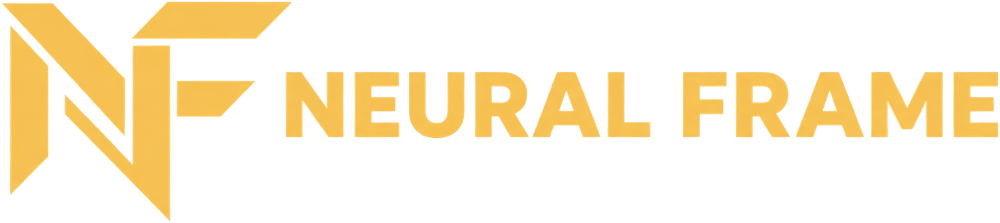
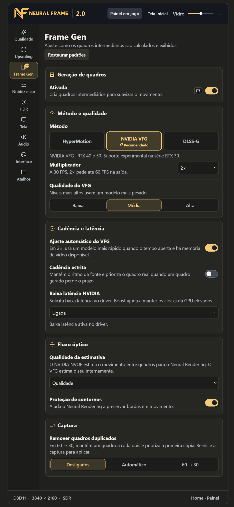

  

<h1 align="center">Neural Frame 2.0</h1>

<strong>Processamento de vídeo em tempo real para jogos no Windows</strong>

<a href="https://github.com/flwless-love/neural-frame-nr/releases">Downloads</a> · <a href="#como-usar">Como usar</a> · <a href="#novidades-da-versão-20">Notas da versão</a> · <a href="#apoie-o-projeto">Apoie o projeto</a>

## O que o aplicativo faz

O Neural Frame recebe a imagem de uma **placa de captura**, de uma **janela** ou da **área de trabalho** e exibe o resultado em tempo real. Assim, você pode ajustar a imagem de um console conectado por HDMI ou acompanhar um jogo de PC na janela de processamento.

- **Neural Rendering** aprimora a imagem. Você pode ajustar a intensidade e a resolução interna de cada camada e salvar suas configurações em perfis.
- **Frame Gen** cria quadros intermediários para suavizar o movimento. Com VFG em 2×, uma fonte estável de 30 FPS pode chegar a 60 FPS na saída.
- **Upscaling** amplia a resolução de saída. O painel exibe as dimensões de entrada e saída para você conferir o resultado.
- **RTX Video HDR** converte vídeo SDR para saída HDR em um monitor compatível.

  
Veja a aba Frame Gen

  

## Downloads

Escolha o arquivo da sua placa de vídeo na seção [Releases](https://github.com/flwless-love/neural-frame-nr/releases).

| Série NVIDIA | Arquitetura | Portátil | Instalador |
| --- | --- | --- | --- |
| RTX 3000 | Ampere | ZIP | EXE |
| RTX 4000 | Ada Lovelace | ZIP | EXE |
| RTX 5000 | Blackwell | ZIP | EXE |

Para usar o **Upscaling NVIDIA**, prefira o instalador da sua série, que inclui o runtime NVIDIA Video Effects correspondente. Para usar a edição portátil, extraia o ZIP inteiro e abra **NeuralFrame.exe**.

## Como usar

1. Escolha a fonte. Para um console por HDMI, selecione **Captura de dispositivo** e escolha a placa de captura.
2. Selecione a resolução, o formato de vídeo e os FPS que deseja capturar. Clique em **Iniciar processamento**.
3. Pressione **Home** para abrir o painel. Use **F6** para alternar o aprimoramento e **F3** para alternar a geração de quadros.
4. Para trocar a fonte ou reiniciar a captura, escolha **Tela inicial** no painel.

### Remover quadros duplicados

Com **NVIDIA VFG** selecionado durante a captura por placa, abra **Frame Gen → Captura → Remover quadros duplicados**.

- **Automático** identifica imagens repetidas e pula esses quadros antes do Neural Rendering e do Frame Gen.
- **60 → 30** mantém um quadro a cada dois. Quando uma captura a 60 FPS repete cada quadro de um jogo a 30 FPS, o app ajusta a alternância para aproveitar a primeira cópia. Use **Desligados** para preservar todos os quadros de uma fonte com 60 FPS reais.

Reinicie a captura para aplicar a escolha.

### Converter SDR para HDR

Ative o HDR no Windows no monitor de saída. Com um sinal SDR, mantenha **HDR da entrada** desligado, escolha **Processamento SDR** e ligue **RTX Video HDR**.

## Novidades da versão 2.0

- **Painel em coluna** com ícones, nomes de abas e controles mais legíveis. Qualidade, Frame Gen, Tela e Interface aproveitam a altura da tela.
- **Tela inicial** encerra o processamento e volta ao seletor de fonte. A próxima sessão começa quando você clicar em **Iniciar processamento**.
- **RTX Video HDR** apresenta o vídeo pela saída HDR e reduz as atualizações de GPU ao abrir o painel.
- **Captura em 1440p** aparece no seletor quando o driver da placa oferece o modo, inclusive em placas como a Elgato 4K Pro.
- **Remover quadros duplicados** agora ajusta a alternância do modo **60 → 30** para priorizar a primeira cópia em capturas com quadros repetidos.

## Apoie o projeto

Se o Neural Frame faz parte da sua configuração, você pode apoiar o desenvolvimento pelo LivePix.

[**Apoiar pelo LivePix**](https://livepix.gg/zanit)
