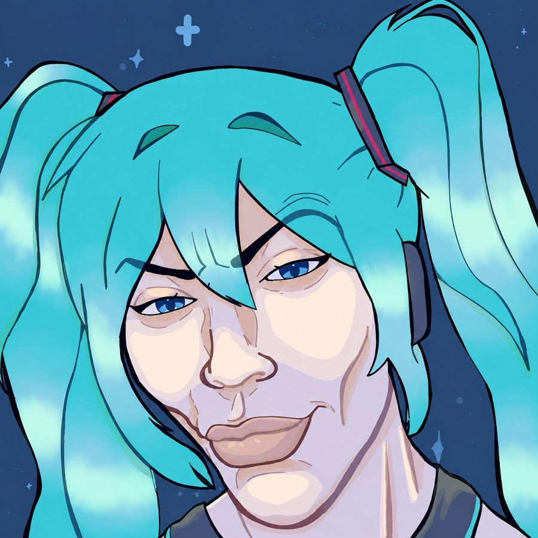

  

<h1 align="center">Neural Frame 2.0</h1>

<strong>Processamento de vídeo em tempo real para jogos no Windows</strong>

<a href="https://github.com/flwless-love/neural-frame-nr/releases">Downloads</a> · <a href="#como-usar">Como usar</a> · <a href="#ps5-streaming">PS5 Streaming</a> · <a href="#novidades-da-versão-20">Notas da versão</a> · <a href="#comunidade-e-apoio">Comunidade e apoio</a>

## O que o aplicativo faz

O Neural Frame recebe a imagem de uma **placa de captura**, de uma **janela** ou da **área de trabalho** e exibe o resultado em tempo real. Assim, você pode ajustar a imagem de um console conectado por HDMI ou acompanhar um jogo de PC na janela de processamento.

- **Neural Rendering** aprimora a imagem. Você pode ajustar a intensidade e a resolução interna de cada camada e salvar suas configurações em perfis.
- **Frame Gen** cria quadros intermediários para suavizar o movimento. Com VFG em 2×, uma fonte estável de 30 FPS pode chegar a 60 FPS na saída.
- **Upscaling** amplia a resolução de saída. O painel exibe as dimensões de entrada e saída para você conferir o resultado.
- **RTX Video HDR** converte vídeo SDR para saída HDR em um monitor compatível.

  
Veja a aba Frame Gen

  

## Downloads

O Neural Frame é distribuído em formato binário. Este repositório público reúne a documentação e os downloads. Os arquivos automáticos “Source code” do GitHub contêm os documentos e as imagens do repositório.

Escolha o arquivo da sua placa de vídeo na seção [Releases](https://github.com/flwless-love/neural-frame-nr/releases).

| Série NVIDIA | Arquitetura | Portátil | Instalador |
| --- | --- | --- | --- |
| RTX 3000 | Ampere | [Portátil em ZIP](https://github.com/flwless-love/neural-frame-nr/releases/download/v2.0/NeuralFrame-2.0-Portable-RTX3000.zip) | [Instalador EXE](https://github.com/flwless-love/neural-frame-nr/releases/download/v2.0/NeuralFrame-Setup-2.0-RTX3000.exe) |
| RTX 4000 | Ada Lovelace | [Portátil em ZIP](https://github.com/flwless-love/neural-frame-nr/releases/download/v2.0/NeuralFrame-2.0-Portable-RTX4000.zip) | [Instalador EXE](https://github.com/flwless-love/neural-frame-nr/releases/download/v2.0/NeuralFrame-Setup-2.0-RTX4000.exe) |
| RTX 5000 | Blackwell | [Portátil em ZIP](https://github.com/flwless-love/neural-frame-nr/releases/download/v2.0/NeuralFrame-2.0-Portable-RTX5000.zip) | [Instalador EXE](https://github.com/flwless-love/neural-frame-nr/releases/download/v2.0/NeuralFrame-Setup-2.0-RTX5000.exe) |

Para usar o **Upscaling NVIDIA**, prefira o instalador da sua série, que inclui o runtime NVIDIA Video Effects correspondente. Para usar a edição portátil, extraia o ZIP inteiro e abra **NeuralFrame.exe**.

## Comunidade e apoio

  
  
  

<table align="center">
  <tr>
    <td align="center">
       
      <strong>Zanit no YouTube</strong> 
      <a href="https://www.youtube.com/@Zanitzada">@Zanitzada</a>
    </td>
    <td align="center">
       
      <strong>Apoie pelo LivePix</strong> 
      <a href="https://livepix.gg/zanit">livepix.gg/zanit</a>
    </td>
  </tr>
</table>

## Como usar

1. Escolha a fonte. Para um console por HDMI, selecione **Captura de dispositivo** e escolha a placa de captura.
2. Selecione a resolução, o formato de vídeo e os FPS que deseja capturar. Clique em **Iniciar processamento**.
3. Pressione **Home** para abrir o painel. Use **F6** para alternar o aprimoramento e **F3** para alternar a geração de quadros.
4. Para trocar a fonte ou reiniciar a captura, escolha **Tela inicial** no painel.

### Remover quadros duplicados

Com **NVIDIA VFG** selecionado durante a captura por placa, abra **Frame Gen → Captura → Remover quadros duplicados**.

- **Automático** identifica imagens repetidas e pula esses quadros antes do Neural Rendering e do Frame Gen.
- **60 → 30** mantém um quadro a cada dois. Quando uma captura a 60 FPS repete cada quadro de um jogo a 30 FPS, o app ajusta a alternância para aproveitar a primeira cópia. Use **Desligados** para preservar todos os quadros de uma fonte com 60 FPS reais.

Reinicie a captura para aplicar a escolha.

### Converter SDR para HDR

Ative o HDR no Windows no monitor de saída. Com um sinal SDR, mantenha **HDR da entrada** desligado, escolha **Processamento SDR** e ligue **RTX Video HDR**.

## Como a imagem é processada

O aplicativo captura os quadros da fonte escolhida e aplica os recursos ativos à imagem. Na captura por placa, o filtro de duplicatas pode remover quadros repetidos antes dos efeitos. O Neural Rendering trabalha na resolução interna de cada camada. A ampliação NVIDIA Light trabalha na saída, e o Frame Gen interpola quadros para a apresentação.

### Escolha da fonte

| Fonte | Quando usar |
| --- | --- |
| **Captura de dispositivo** | Console ou outro PC via HDMI. Selecione a placa, a resolução, o formato de vídeo e a taxa que ela oferece. |
| **Aplicativo ou jogo** | Processar apenas uma janela no PC. O modo **Sobrepor** exibe o resultado sobre a janela escolhida quando disponível. |
| **Área de trabalho completa** | Processar a imagem de um monitor. Você pode escolher se o ponteiro aparece na captura. |
| **PS5 Streaming** | Receber imagem e áudio do PS5 pela rede local ou usar o controle remoto com a imagem de uma placa HDMI. |

A lista de resoluções e formatos da placa depende do driver e do sinal. O **Modo GTA 6 (Beta)** é uma predefinição opcional de processamento para capturas com 30 FPS exatos.

### O que cada aba controla

| Aba | Controles principais |
| --- | --- |
| **Qualidade** | Ativa o Neural Rendering, escolhe a resolução interna e ajusta força, tom, estrutura e modelo. É possível adicionar, duplicar e restaurar camadas, estabilizar as cores em SDR e salvar ou carregar perfis. |
| **Upscaling** | Mostra a resolução recebida e a resolução prevista na saída. O modo NVIDIA Light oferece 1,5× e 2×, e a opção 1440p aparece quando compatível com a fonte. O controle de nitidez do Light atua nessa etapa. Mudanças na resolução de saída podem pedir o reinício da captura. |
| **Frame Gen** | Seleciona o método, o multiplicador e a qualidade. O NVIDIA VFG em 2× costuma ser o ponto de partida para uma fonte de 30 FPS. Na série RTX 3000, o suporte ao VFG é experimental. O ajuste automático do VFG pode usar um modelo mais leve em 2×. Cadência estrita e baixa latência NVIDIA controlam a apresentação em métodos compatíveis. O fluxo óptico NVOF fornece estimativas de movimento ao Neural Rendering, com proteção de contornos opcional. |
| **Nitidez e cor** | Ajusta a nitidez da imagem e controles de cor, incluindo saturação e gama. A gama atua nos tons intermediários. Os controles com seta curva voltam ao valor padrão. |
| **HDR** | Configura o HDR de entrada e a saída. O RTX Video HDR converte SDR para HDR e tem controles de contraste, saturação, cinza médio e brilho de pico. Para um sinal que já chega em HDR, use a configuração de HDR da entrada adequada à fonte. |
| **Tela** | Controla tela cheia, limite de FPS, V-Sync, contador, cursor e opções de apresentação da sessão. |
| **Áudio** | Ajusta o volume ou silencia o áudio da sessão. O controle rápido também pode ser aberto com o botão direito quando habilitado. |
| **Interface** | Ajusta tamanho, cor e intensidade do vidro do painel, avisos e indicadores sobre a imagem. |
| **Atalhos** | Mostra e permite personalizar os comandos do painel. Os atalhos iniciais incluem **Home** para o painel, **F3** para Frame Gen, **F6** para Neural Rendering, **F11** para tela cheia e **Alt + Esc** para sair da sessão. |

## PS5 Streaming

O **PS5 Streaming** usa o Uso remoto do console na mesma rede. Você pode receber o vídeo pelo próprio stream ou combinar o controle pela rede com a imagem da placa HDMI.

### Parear o console

1. Conecte o PC e o PS5 à mesma rede. No console, vá a **Configurações → Sistema → Uso remoto** e habilite o recurso.
2. Na tela inicial do Neural Frame, abra **PS5 Streaming**. Clique em **Buscar** para localizar o console ou digite o endereço IPv4 do PS5.
3. Preencha o **ID da conta PSN** em formato numérico ou Base64. O botão **Obter ID** abre uma página externa para consultar esse identificador.
4. No PS5, escolha **Emparelhar dispositivo** dentro de **Uso remoto**. Digite o código de oito dígitos exibido pelo console no Neural Frame e clique em **Parear e salvar**.
5. Ajuste **Vídeo e controle** e clique em **Conectar**. Se o PS5 pedir o PIN de login, informe o código de quatro dígitos nessa tela.

O pareamento fica armazenado no PC e protegido pelo Windows. **Remover** apaga o pareamento salvo nesse computador. Para usar **Despertar** com o PS5 em repouso, habilite as opções de conexão e de ligar pela rede no menu de economia de energia do console. [Configurações do Uso remoto no PlayStation](https://www.playstation.com/pt-br/support/games/remote-play-settings/) · [Uso remoto e modo de repouso](https://www.playstation.com/pt-br/support/games/playstation-remote-play-on-pc-and-mac/)

### Vídeo e controle

| Ajuste | Como funciona |
| --- | --- |
| **Resolução e FPS** | Escolha 720p ou 1080p, a 30 ou 60 FPS. Isso configura o stream pela rede. |
| **Codec** | H.264 e H.265 para SDR. H.265 HDR requer HDR no PS5 e no monitor de saída no Windows. Se usar Frame Gen, escolha um método compatível com HDR. |
| **Bitrate** | Ajusta a taxa em Mbps solicitada para o stream. |
| **Decodificação** | **Auto** deixa a escolha para o app. **CPU** decodifica por software. **D3D12VA** usa aceleração de hardware compatível. |
| **Amostragem fina** | Ajusta como o app reconstrói a imagem recebida antes de aplicar os efeitos. |
| **Somente visualizar** | Exibe o stream sem enviar os comandos do controle ao PS5. |
| **Vídeo da placa HDMI** | Recebe a imagem da placa enquanto o Uso remoto envia o controle pela rede. Antes de conectar, escolha a placa, a resolução, o formato e os FPS na tela inicial. Desative **Somente visualizar** para usar esse modo. |

## Gravação e transmissão no OBS

Na tela inicial, abra **Saída para OBS**. Em **Captura de jogo**, selecione no OBS a janela de vídeo do Neural Frame, que recebe a imagem processada. **Spout** é uma opção de saída separada e usa o plugin correspondente no OBS. Se quiser manter o painel e os avisos fora da transmissão, habilite **Ocultar painel durante captura**.

## Novidades da versão 2.0

- **Painel em coluna** com ícones, nomes de abas e controles mais legíveis. Qualidade, Frame Gen, Tela e Interface aproveitam a altura da tela.
- **Tela inicial** encerra o processamento e volta ao seletor de fonte. A próxima sessão começa quando você clicar em **Iniciar processamento**.
- **RTX Video HDR** apresenta o vídeo pela saída HDR e reduz as atualizações de GPU ao abrir o painel.
- **Captura em 1440p** aparece no seletor quando o driver da placa oferece o modo, inclusive em placas como a Elgato 4K Pro.
- **Remover quadros duplicados** agora ajusta a alternância do modo **60 → 30** para priorizar a primeira cópia em capturas com quadros repetidos.
